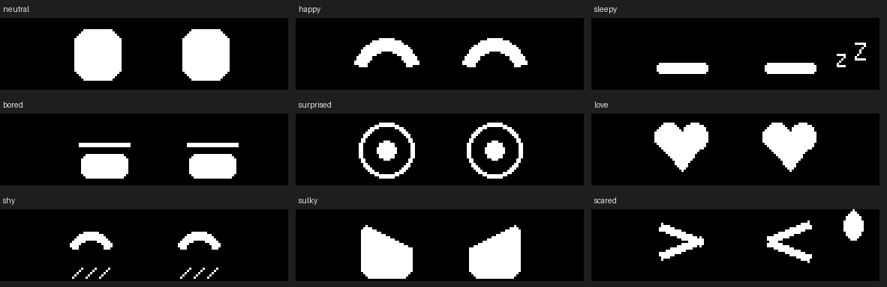

# 🤖 라즈봇 손짓 로봇 (Razbot Gesture Robot)

라즈베리파이 5 + 라즈봇 V2(Yahboom Raspbot V2) 위에서 동작하는 **손짓 인식 로봇**입니다.
웹캠으로 손을 인식해 로봇을 조종하고, TV 속 골·홈런 장면에 세레머니를 하고, 손짓으로 감정을 주고받습니다.
모든 기능은 브라우저 웹 화면(`http://<라즈베리파이 IP>:5000`)에서 보고 조작할 수 있습니다.

기획: <https://dididip.github.io/razbot2-gesture-robot/>

## 기능 (웹 화면의 탭 3개)

### ✋ 손 조종
| 손 모양 | 동작 |
|---|---|
| ✌️ 가위 | 전진 (계속) |
| ✋ 보 | 후진 (계속) |
| ✊ 주먹 | 정지 |

- 같은 손 모양 4프레임(약 0.25초) 유지 시 명령 변경
- 손이 1초 넘게 안 보이면 자동 정지 (안전장치)
- 웹에서 속도 조절 (30~255)

### ⚽ 경기 관람
카메라를 TV/모니터에 비추면 로컬 AI(CLIP ViT-B-32)가 0.8초마다 장면을 판정해
**골·홈런 장면**이면 세레머니(삐삐삐 → 한 바퀴 → 앞뒤 → 좌우 → 반대로 한 바퀴 → 삐~)를 합니다.

- "골 세레머니", "골망에 들어간 공", "홈런 타구" 등 7개 문장과 "평범한 경기 장면", "광고" 등 12개 문장을 비교
- 기준(기본 60%)을 2번 연속 넘으면 실행, 이후 20초 쿨다운
- 웹에서 실시간 점수 그래프, 민감도 조절, 세레머니 테스트 버튼

### 🐶 교감 (감정 표현)
OLED 얼굴 표정 + 몸짓 + 부저 리듬으로 감정을 표현합니다.



| 손짓 | 로봇 반응 |
|---|---|
| 👋 손을 빠르게 좌우로 흔들기 | 인사 (아침 ☀️ / 낮 / 밤 🌙 "잘 자") |
| ✋ 손바닥을 펴고 가만히 | 하이파이브 (톡 다가왔다 돌아옴) |
| 🤚 손을 천천히 크게 좌우로 | 쓰담쓰담 (하트 눈, 살랑살랑) |
| 👍 엄지 척 | 칭찬 (하트, 부끄러워 뒤로 살짝) |
| 👊 주먹을 휘두르거나 들이밀기 | 깜짝 놀라 뒤로 주춤, 한동안 벌벌 떪 |
| 🙈 한동안 안 놀아 주기 | 심심 → "놀아줘" 다가오기 → 3번 무시하면 삐져서 등 돌림 |

**기분에 따라 평소 행동이 달라집니다** (반응이 없는 동안 몇 초마다 반복):

| 기분 | 행동 |
|---|---|
| 😐 평온 | 두리번두리번 |
| 😊 기쁨 | 들썩들썩 춤 (애정도가 높을수록 자주) |
| 🥰 사랑 | 살금살금 다가가 비비기 |
| ☺️ 부끄럼 | 꼼지락꼼지락 |
| 🥱 심심 | 어슬렁어슬렁 돌아다니기 |
| 😴 졸림 | 꾸벅꾸벅 |
| 😤 삐짐 | "흥!" 고개 홱 |
| 😨 무서움 | 벌벌 떨며 뒷걸음 |

- 애정도(인사 +1, 하이파이브 +1, 쓰담 +2, 칭찬 +3, 위협 −1)는 `affection.json`에 저장
- 부저는 음높이가 하나라서 감정을 **리듬**으로 구분합니다
- 로봇이 움직이는 동안에는 손 움직임을 무시합니다 (카메라가 로봇에 달려 있어 생기는 오인식 방지)

## 하드웨어
- Raspberry Pi 5 (8GB), Debian 13 (trixie), Python 3.13
- 라즈봇 V2 확장보드: I2C `0x2B` (모터 4개 + 부저)
- OLED SSD1306 128×32: I2C `0x3C`
- USB 웹캠 (`/dev/video0`)

## 설치 & 실행
```sh
git clone https://github.com/jang20050/razbot-gesture-robot.git ~/razbot
cd ~/razbot
./setup.sh          # I2C 켜기, 가상환경, 패키지, 손 인식 모델 다운로드
python3 robot.py    # 모터 4개 하나씩 + 부저 테스트 (바퀴가 돕니다!)
./run.sh            # 앱 실행 → http://<라즈베리파이 IP>:5000
```
- 처음 "경기 관람" 모드를 켜면 CLIP 모델(약 600MB)을 내려받느라 1~2분 걸립니다.
- 로봇은 **"로봇 움직이기"를 체크해야** 실제로 움직입니다 (기본값 꺼짐).
- 종료: `pkill -f "venv/bin/python app.py"`, 로그: `app.log`
- 옵션: `./run.sh --cam 1 --port 8080 --no-robot`

## 파일 구조
| 파일 | 역할 |
|---|---|
| `app.py` | Flask 웹 서버 + 웹 화면, 카메라 루프, 모드 전환 |
| `robot.py` | I2C 모터·부저 제어, 몸짓/세레머니 동작 |
| `gesture.py` | MediaPipe HandLandmarker(Tasks API)로 손 관절 21개 → 바위/가위/보/엄지 판정 |
| `control.py` | 손 조종 모드 (가위=전진, 보=후진, 주먹=정지) |
| `scene.py` | CLIP 제로샷 장면 분류로 골·홈런 감지 |
| `face.py` | OLED 표정 애니메이션 9종 (웹 미리보기 겸용) |
| `companion.py` | 교감 모드: 손짓 동역학(흔들기·쓰다듬기·위협) 감지, 기분 상태, 애정도, 기분별 행동 |
| `setup.sh` / `run.sh` | 설치 / 실행 스크립트 |

## 조정 포인트
- 회전 각도(삐짐 반 바퀴, 세레머니 한 바퀴)는 바닥 마찰에 따라 다르니 `robot.py`의 시간 값을 조정
- 장면 감지 문장은 `scene.py`의 `POSITIVE` / `NEGATIVE`
- 손짓 감지 기준은 `companion.py`의 `_is_wave`, `_is_stroke`, `_is_threat`
